<picture>
  <source media="(prefers-color-scheme: dark)" srcset="board_dark.svg">
  
</picture>

### Dedoo Projects

**Scrypt AuxPoW, block by block.** Explorer, PSOB and wallets for Scrypt AuxPoW chains — plus select UTXO networks.

[dedoo.xyz](https://dedoo.xyz) · [Explorer](https://dedoo.xyz/explorer/junkcoin) · [Wallet](https://dedoo.xyz/wallet) · [Developers](https://dedoo.xyz/developers) · [@dedooxyz](https://x.com/dedooxyz)

### Products

| | |
| --- | --- |
| **[Explorer](https://dedoo.xyz/explorer/junkcoin)** | Blocks, mempool, transactions and addresses across every indexed network |
| **[PSOB Explorer](https://dedoo.xyz/research)** | Sibling-block proofs and live sibling groups from the PSob indexer |
| **[Wallet](https://dedoo.xyz/wallet)** | Non-custodial Android and Chrome wallet with multi-sig, PSBT and Nostr |
| **[Trade](https://trade.dedoo.xyz)** | Perpetual synthetic markets |
| **[Marketplace](https://dedoo.xyz/marketplace/junkcoin)** | Ordinals, DRC-20 and PRC-20 listings with on-chain settlement |
| **[Bridge](https://dedoo.xyz/bridge)** | Move assets between supported UTXO networks through the PSob bridge |
| **[Developers](https://dedoo.xyz/developers)** | API keys, RPC endpoints and indexed data for builders |

### Selected repositories

| | |
| --- | --- |
| **[utxo-vm](https://github.com/dedooxyz/utxo-vm)** | Universal clean-room smart-object protocol for any UTXO blockchain |
| **[psob-indexer](https://github.com/dedooxyz/psob-indexer)** | Sibling-block indexer for PSob |
| **[zk-scrypt-lightclient](https://github.com/dedooxyz/zk-scrypt-lightclient)** | RISC Zero zkVM light client for scrypt-PoW + AuxPoW chains |
| **[dedoo-mm](https://github.com/dedooxyz/dedoo-mm)** | m-of-n multisig keeper for WojakCoin and Junkcoin |
| **[dedoo-wallet-sdk](https://github.com/dedooxyz/dedoo-wallet-sdk)** | TypeScript client for the Dedoo Extension Wallet dapp provider |
| **[psob-sdk](https://github.com/dedooxyz/psob-sdk)** | TypeScript SDK for PSob |

Everything we open source lives in this organisation: **[github.com/dedooxyz](https://github.com/dedooxyz)**
